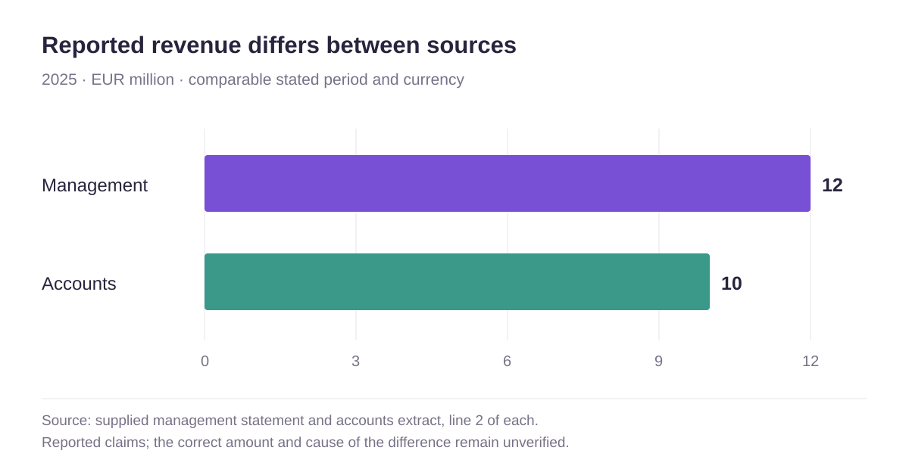

# Review report

## Executive Assessment

This review is limited to the two supplied revenue statements and the stated mandate to compare them for the same year and currency; both statements concern 2025 and use EUR, but report different amounts. [^e1] [^e2]

**Confidence:** high. **Uncertainty:** The comparison is limited to the supplied documents; no underlying accounting records or additional context were provided. [^e1] [^e2]

The reported amounts differ by EUR 2 million, so the supplied statements do not establish a consistent 2025 revenue figure and require reconciliation. [^e3] [^e4]

**Confidence:** high. **Uncertainty:** The discrepancy is clear in the statements, but the evidence does not explain its cause or establish which amount is correct. [^e3] [^e4]

## Criterion-by-Criterion Review

### Revenue consistency

**Status:** partial. [^e5] [^e6]

The statements are comparable on the stated year and currency, but report EUR 12 million and EUR 10 million respectively; consistency remains unresolved pending reconciliation. [^e5] [^e6]

**Confidence:** high. **Uncertainty:** The evidence permits comparison of the stated figures but does not provide definitions, accounting basis, or supporting records to explain the difference. [^e5] [^e6]

## Findings

The two supplied sources report different revenue amounts for 2025 in EUR million. The comparison shows reported claims, not verified revenue. [^e1] [^e2]

The management statement reports 2025 revenue of EUR 12 million. [^e7]

**Confidence:** high. **Uncertainty:** This establishes what the supplied statement says, not whether the figure is accurate or how it was calculated. [^e7]

The accounts extract reports 2025 revenue of EUR 10 million. [^e8]

**Confidence:** high. **Uncertainty:** This establishes what the supplied extract says, not whether the figure is accurate or how it was calculated. [^e8]

## Risks

If the statements are intended to report the same revenue measure, relying on either figure without reconciliation could lead to an inaccurate understanding of 2025 revenue. [^e9] [^e10]

**Confidence:** medium. **Uncertainty:** The evidence does not establish whether the statements use the same revenue definition or reporting basis, or whether either figure was relied upon. [^e9] [^e10]

## Contradictions

The management statement reports EUR 12 million and the accounts extract reports EUR 10 million for 2025; the figures differ by EUR 2 million despite stating the same year and currency. [^e11] [^e12]

**Confidence:** high. **Uncertainty:** The supplied text does not clarify whether the documents use different revenue definitions, scopes, or accounting bases, so the difference is an unresolved discrepancy rather than an established error. [^e11] [^e12]

## Missing Evidence

The reviewed collection does not include a reconciliation or supporting detail explaining why the two supplied 2025 revenue figures differ; request these materials to substantiate the amounts and their comparability. [^e13] [^e14]

**Confidence:** medium. **Uncertainty:** This observation is limited to the two supplied statements and does not establish that such materials do not exist elsewhere. [^e13] [^e14]

## Questions to Ask

Which 2025 revenue figure is intended to be authoritative, and what reconciliation supports the difference between EUR 12 million and EUR 10 million? [^e15] [^e16]

**Confidence:** high. **Uncertainty:** The supplied statements do not identify an authoritative figure or explain the discrepancy. [^e15] [^e16]

Do both statements use the same revenue definition, entity scope, and accounting basis for 2025? [^e17] [^e18]

**Confidence:** medium. **Uncertainty:** The statements specify year and currency but provide no definition, scope, or accounting-basis details. [^e17] [^e18]

## Recommendations

Obtain a reconciliation of the EUR 12 million and EUR 10 million figures, including their definitions, scope, and accounting basis, before concluding which 2025 revenue amount is supportable. [^e19] [^e20]

**Confidence:** high. **Uncertainty:** The supplied evidence identifies the differing amounts but does not show what reconciliation or supporting records are available. [^e19] [^e20]

## Confidence / uncertainty

Confidence is high that the two supplied statements report different amounts for the same stated year and currency, and low regarding the correct revenue figure or cause of the discrepancy. [^e21] [^e22]

**Confidence:** high. **Uncertainty:** The review has only two brief statements, with no supporting records, reconciliation, or evidence of source independence. [^e21] [^e22]

[^e1]: [management](sources/management.md#L2-L2)
    > Revenue in 2025 was EUR 12 million.

[^e2]: [accounts](sources/accounts.md#L2-L2)
    > Revenue in 2025 was EUR 10 million.

[^e3]: [management](sources/management.md#L2-L2)
    > Revenue in 2025 was EUR 12 million.

[^e4]: [accounts](sources/accounts.md#L2-L2)
    > Revenue in 2025 was EUR 10 million.

[^e5]: [management](sources/management.md#L2-L2)
    > Revenue in 2025 was EUR 12 million.

[^e6]: [accounts](sources/accounts.md#L2-L2)
    > Revenue in 2025 was EUR 10 million.

[^e7]: [management](sources/management.md#L2-L2)
    > Revenue in 2025 was EUR 12 million.

[^e8]: [accounts](sources/accounts.md#L2-L2)
    > Revenue in 2025 was EUR 10 million.

[^e9]: [management](sources/management.md#L2-L2)
    > Revenue in 2025 was EUR 12 million.

[^e10]: [accounts](sources/accounts.md#L2-L2)
    > Revenue in 2025 was EUR 10 million.

[^e11]: [management](sources/management.md#L2-L2)
    > Revenue in 2025 was EUR 12 million.

[^e12]: [accounts](sources/accounts.md#L2-L2)
    > Revenue in 2025 was EUR 10 million.

[^e13]: [management](sources/management.md#L2-L2)
    > Revenue in 2025 was EUR 12 million.

[^e14]: [accounts](sources/accounts.md#L2-L2)
    > Revenue in 2025 was EUR 10 million.

[^e15]: [management](sources/management.md#L2-L2)
    > Revenue in 2025 was EUR 12 million.

[^e16]: [accounts](sources/accounts.md#L2-L2)
    > Revenue in 2025 was EUR 10 million.

[^e17]: [management](sources/management.md#L2-L2)
    > Revenue in 2025 was EUR 12 million.

[^e18]: [accounts](sources/accounts.md#L2-L2)
    > Revenue in 2025 was EUR 10 million.

[^e19]: [management](sources/management.md#L2-L2)
    > Revenue in 2025 was EUR 12 million.

[^e20]: [accounts](sources/accounts.md#L2-L2)
    > Revenue in 2025 was EUR 10 million.

[^e21]: [management](sources/management.md#L2-L2)
    > Revenue in 2025 was EUR 12 million.

[^e22]: [accounts](sources/accounts.md#L2-L2)
    > Revenue in 2025 was EUR 10 million.
